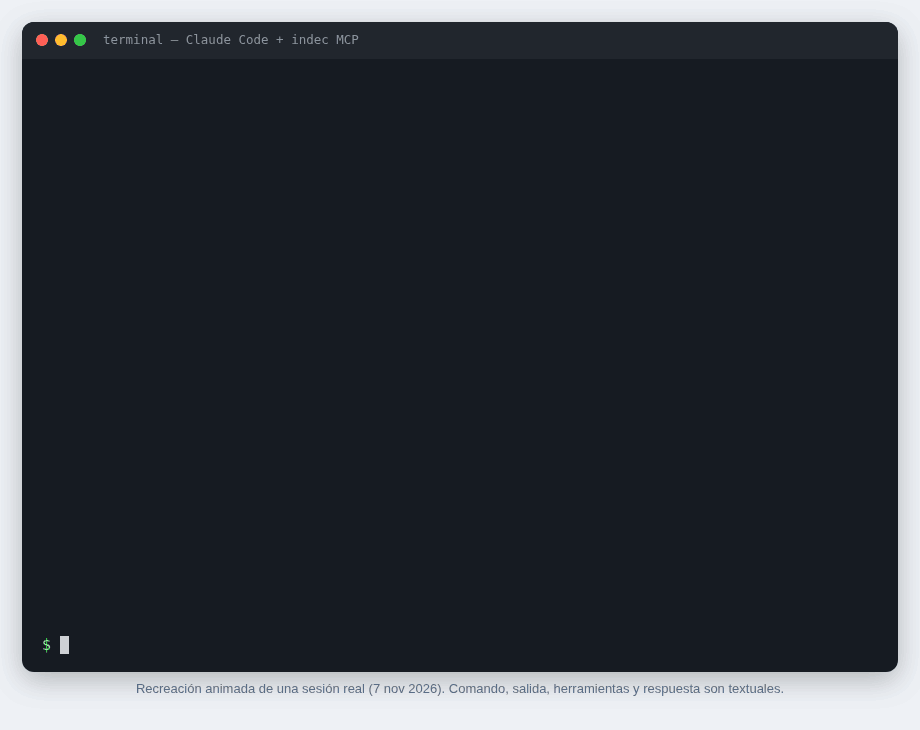
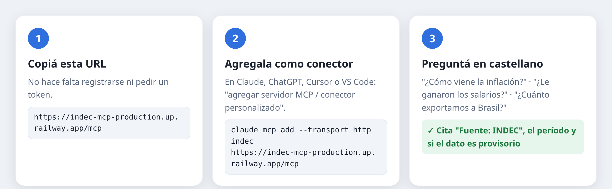
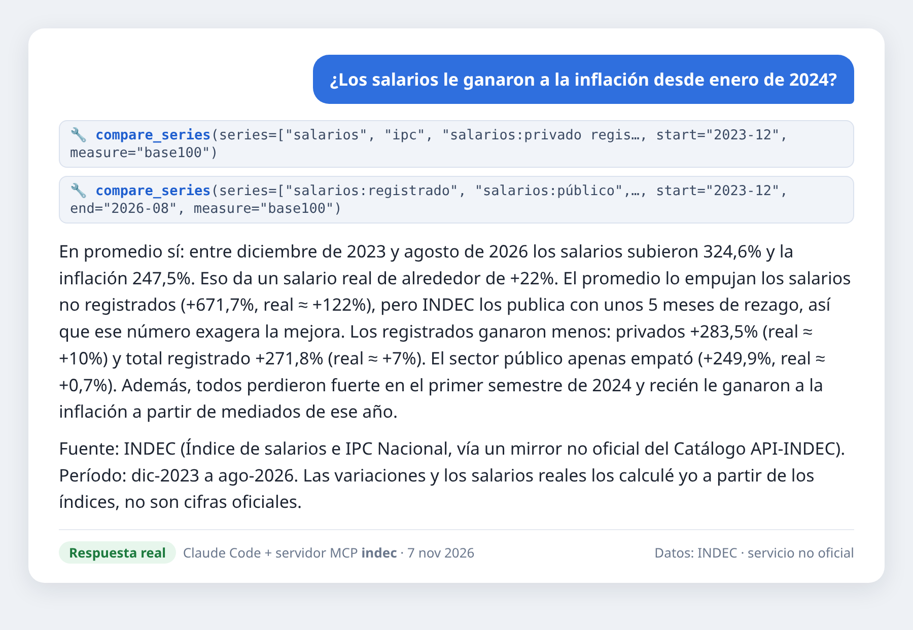
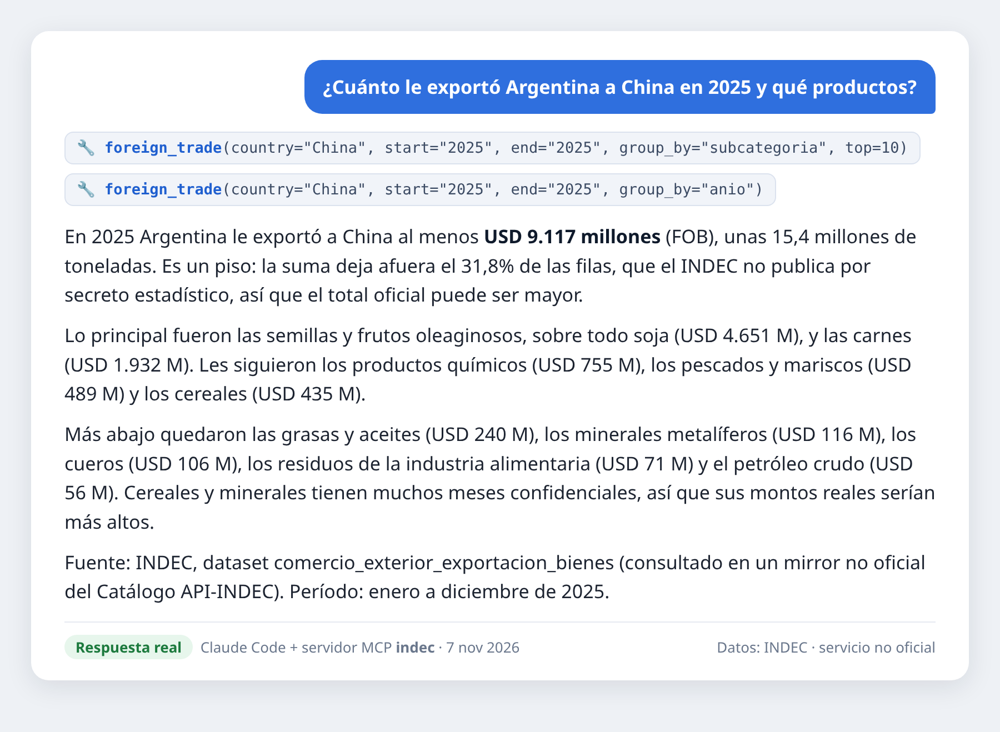
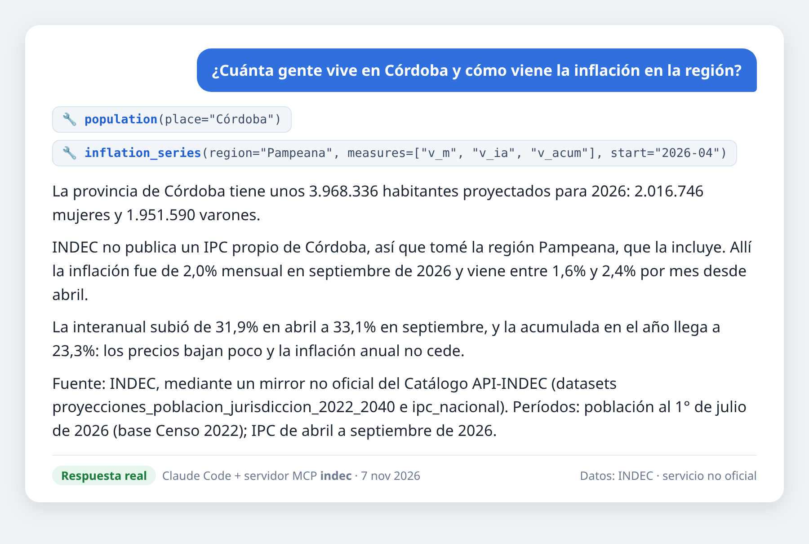

# INDEC en tu asistente de IA

**Preguntale a Claude, ChatGPT o Cursor por la inflación, los salarios, la pobreza, las exportaciones o la población de Argentina, y te responde con los datos oficiales del INDEC.**
Sin registrarte, sin token y sin instalar nada: pegás una URL y listo.



> Servicio **no oficial**, no afiliado al INDEC. Los datos son del INDEC (Catálogo API-INDEC). Fuente: INDEC.

---

## Empezá en 1 minuto



Esta es la única URL que necesitás:

```
https://indec-mcp-production.up.railway.app/mcp
```

Elegí tu aplicación:

<details open>
<summary><b>Claude Code</b> (terminal)</summary>

```bash
claude mcp add --transport http indec https://indec-mcp-production.up.railway.app/mcp
```

Agregá `--scope user` para tenerlo en todos tus proyectos. Después abrí `claude` y preguntá.
</details>

<details>
<summary><b>Claude</b> (claude.ai o la app de escritorio)</summary>

1. Andá a **Configuración → Conectores** y elegí **Agregar conector personalizado**.
2. Nombre: `INDEC`. URL: `https://indec-mcp-production.up.railway.app/mcp`. No requiere autenticación.
3. En un chat nuevo, activá el conector **INDEC** y preguntá.

*Los conectores personalizados pueden depender de tu plan.*
</details>

<details>
<summary><b>ChatGPT</b></summary>

Con el **modo desarrollador** activado, creá un conector o app nueva de tipo servidor MCP con la URL `https://indec-mcp-production.up.railway.app/mcp`, sin autenticación. Después activalo en el chat.

*La disponibilidad depende de tu plan y del menú de ChatGPT, que cambia seguido.*
</details>

<details>
<summary><b>Cursor</b></summary>

En `~/.cursor/mcp.json` (para todos tus proyectos) o en `.cursor/mcp.json` (solo uno):

```json
{
  "mcpServers": {
    "indec": { "url": "https://indec-mcp-production.up.railway.app/mcp" }
  }
}
```
</details>

<details>
<summary><b>VS Code</b> (GitHub Copilot)</summary>

En `.vscode/mcp.json`:

```json
{
  "servers": {
    "indec": { "type": "http", "url": "https://indec-mcp-production.up.railway.app/mcp" }
  }
}
```
</details>

<details>
<summary><b>Otra aplicación</b></summary>

Sirve cualquier cliente MCP que acepte servidores remotos por **Streamable HTTP**: usá la URL de arriba, sin autenticación.
</details>

---

## Qué le podés preguntar

| Tema | Por ejemplo |
|---|---|
| **Inflación** | "¿Cuánto fue la inflación del último mes? ¿Y la núcleo?" · "¿Cómo viene alimentos en el NOA comparado con GBA?" |
| **Salarios** | "¿Los salarios le ganaron a la inflación desde enero de 2024?" · "¿Y los del sector público?" |
| **Canasta básica** | "¿Cuánto necesita una familia tipo para no ser pobre?" · "¿Cuánto subió la canasta en un año?" |
| **Pobreza y empleo** | "¿Cómo evolucionó la pobreza desde 2016?" · "¿Cuál es la desocupación hoy?" |
| **Actividad** | "¿Está creciendo la economía según el EMAE?" · "¿Cómo viene la industria?" |
| **Comercio exterior** | "¿Cuánto le exportamos a China en 2025 y qué productos?" · "¿Cuánto importamos en bienes de capital por año?" |
| **Población** | "¿Cuánta gente vive en Córdoba?" · "¿Cuál es el departamento más poblado de Mendoza?" |
| **Lo que quieras** | Precios mayoristas, costo de la construcción, minería y más: el asistente puede consultar los 19 datasets |

En los clientes que muestran *prompts* MCP también tenés atajos listos: **informe de inflación**, **panorama económico**, **evolución de la pobreza**, **comercio con un país** y **salario real**.

## Ejemplos reales

Respuestas sin editar, generadas con Claude Code conectado a este servidor ([transcripciones](docs/img/demos.json)):



<details>
<summary>Más ejemplos: exportaciones a China · población e inflación de Córdoba</summary>




</details>

---

## Por qué usar este servidor

- **Es el más simple de usar.** Una URL y listo: no hace falta registrarse en el INDEC, pedir ni renovar un token, ni instalar Node o Python.
- **Responde con cuidado.** Le indica al asistente que cite "Fuente: INDEC" con el período de cada cifra, que avise cuando un dato es provisorio y que use las variaciones que publica el INDEC en lugar de calcularlas. Si el asistente calcula algo (por ejemplo, el salario real), tiene que decirlo.
- **No esconde los huecos.** En comercio exterior, parte de las filas de detalle son confidenciales por secreto estadístico (en los meses recientes, cerca de la mitad). El servidor informa siempre cuántas son, así el asistente no presenta una suma parcial como si fuera el total.
- **Es rápido y estable.** Trabaja sobre una copia de todos los datos que se actualiza cada día, así que no depende de que la API del INDEC (todavía en beta) esté funcionando en ese momento.
- **Cuida al INDEC.** Haya los usuarios que haya, la API del INDEC recibe solo unas 2.000 consultas por día, las de la actualización diaria.
- **Es código abierto** ([MIT](LICENSE)), y podés correrlo vos mismo ([docs/development.md](docs/development.md)).

### Otras opciones

| | Este servidor | [indec-mcp de SantinoSpingola](https://github.com/SantinoSpingola/indec-mcp) | [OpenArg](https://openarg.org/) |
|---|---|---|---|
| Cómo se usa | Pegás una URL | Se instala en tu computadora (Node) | Chat web, API y MCP |
| Registro o token | **No hace falta** | Token propio del INDEC | Clave de OpenArg |
| Uso gratis | 2.000 consultas por día | Lo que permita el INDEC | 200 consultas y 10 preguntas por mes |
| Cobertura | INDEC, en profundidad | INDEC, en profundidad | Más de 33.000 datasets de 38 portales públicos |

Si querés datos de muchos organismos además del INDEC, OpenArg cubre más fuentes. Si preferís consultar la API del INDEC en vivo con tu propio token, el proyecto de Santino es muy completo. Este servidor apunta a que cualquiera pueda preguntar sobre el INDEC sin ningún paso previo.

---

## Datos incluidos

Los **19 servicios de datos** del [Catálogo API-INDEC](https://api.indec.gob.ar), unos 2 millones de filas, actualizados todos los días a las 19:00 (hora de Argentina). El INDEC publica sus informes a las 16:00.

- **Precios:** IPC por región y categoría (desde dic-2016), canastas básicas CBA y CBT (desde abr-2016), precios mayoristas, costo de la construcción y redeterminación de obras públicas
- **Salarios:** índice de salarios por sector
- **Actividad:** EMAE (general y por sectores) e índice de producción industrial manufacturera y minera
- **Condiciones de vida:** pobreza e indigencia (semestral), mercado de trabajo (trimestral) y canasta de crianza
- **Comercio exterior:** exportaciones (desde 1986) e importaciones, por país y categoría
- **Población:** proyecciones 2022–2040 por provincia, sexo y edad, y estimaciones por departamento 2022–2035 (base Censo 2022)

Estado y fecha de la última actualización: <https://indec-mcp-production.up.railway.app/healthz>

## Límites de uso

Para que el servicio siga siendo gratis y estable para todos, hay un límite por conexión:

- hasta **20 consultas seguidas**, después **30 por minuto**;
- hasta **2.000 por día**.

Una pregunta normal usa pocas consultas, entre 2 y 10. Si llegás al límite, el asistente recibe un aviso para esperar unos segundos.

## Preguntas frecuentes

**¿Es oficial?** No. Es un proyecto independiente que usa la API pública del INDEC. Ante cualquier duda, la referencia es [indec.gob.ar](https://www.indec.gob.ar).

**¿Ven mis conversaciones?** No. El servidor solo recibe las consultas de datos que hace el asistente (por ejemplo, "IPC de Alimentos desde 2025"), no tu chat. El programa no guarda registros de acceso con direcciones IP: para los límites de uso solo registra un resumen cifrado (hash). La plataforma de hosting (Railway) puede tener sus propios registros de red. Tu conversación la procesa tu aplicación de IA (Claude, ChatGPT…) según sus propias políticas.

**¿Cuesta algo?** El servidor es gratis. Lo que uses de tu asistente de IA depende de tu plan con ese servicio.

**¿Por qué una cifra no coincide exactamente con el informe del INDEC?** Puede pasar por redondeo cuando se calcula una variación, o porque en comercio exterior se excluyen los datos confidenciales. El asistente debería aclararlo en esos casos.

**¿Puedo instalarlo en mi propio servidor?** Sí: [docs/development.md](docs/development.md) explica cómo correrlo y [docs/deploy.md](docs/deploy.md) cómo publicarlo.

## Para desarrolladores

- [docs/development.md](docs/development.md): arquitectura, herramientas MCP, cómo correrlo localmente y tests
- [docs/deploy.md](docs/deploy.md): despliegue, configuración, protección contra abuso y operación
- [docs/api-research.md](docs/api-research.md): cómo funciona la API del INDEC, con mediciones reales
- [docs/datasets.md](docs/datasets.md): los 19 datasets con sus columnas

## Créditos

- **Datos:** [INDEC](https://www.indec.gob.ar), mediante el [Catálogo API-INDEC](https://api.indec.gob.ar).
- **Ideas:** varias funciones (buscar códigos de comercio exterior por nombre, informar los datos confidenciales, los *prompts* y la guía de signos convencionales) están inspiradas en [SantinoSpingola/indec-mcp](https://github.com/SantinoSpingola/indec-mcp) (MIT). Se reimplementaron en Python, sin copiar su código.
- **Licencia:** [MIT](LICENSE).

---

## English

**Ask Claude, ChatGPT or Cursor about Argentina's official statistics (INDEC): inflation, wages, poverty, trade and population.** There's no signup, no API token and nothing to install. Add this remote MCP server (Streamable HTTP, no auth):

```
https://indec-mcp-production.up.railway.app/mcp
```

The server holds a daily copy of all 19 datasets in INDEC's new API. It offers 9 read-only tools (headline indicators, CPI series, series comparison such as real wages, foreign trade with name lookup, population, and sandboxed SQL), plus 5 prompts and resources. Answers cite INDEC with the period of each figure and flag provisional or confidential data. Limits are 20 requests in a burst, 30 per minute and 2,000 per day for each client. The project is unofficial and MIT-licensed. Technical documentation is in [docs/development.md](docs/development.md).
